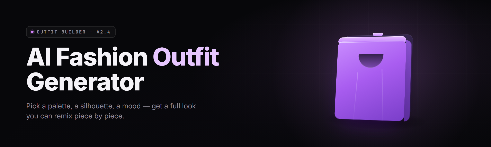

  
  
  

  

  
  
  

---

**Stop scrolling Pinterest at 11pm. Type a vibe, get a full fit in 40 seconds.**
A 2026 desktop outfit engine that reads your closet, your body, and the weather — then drops a wearable look you can actually leave the house in.

---

## 🧭 Table of Contents

- [The Solution — Problem | Solution](#-the-solution)
- [System Requirements](#-system-requirements)
- [What is the AI Outfit Generator?](#-what-is-the-ai-outfit-generator)
- [Overview](#-overview)
- [Key Features](#-key-features)
- [Wardrobe Intelligence Modules](#-wardrobe-intelligence-modules)
- [Styling Engine Modules](#-styling-engine-modules)
- [Body & Fit Modules](#-body--fit-modules)
- [Occasion & Context Modules](#-occasion--context-modules)
- [Export & Shopping Modules](#-export--shopping-modules)
- [Tips for Best Results](#-tips-for-best-results)
- [The Problem](#-the-problem)
- [Known Issues](#-known-issues)
- [Comparison](#-comparison)
- [All Modules Status](#-all-modules-status)
- [Usage Guidelines](#-usage-guidelines)
- [FAQ](#-faq)

---

## 🧩 The Solution

| Problem | Solution |
| --- | --- |
| Closet full, "nothing to wear" | Closet scanner indexes every garment into a tagged digital wardrobe |
| Endless scroll for inspiration | Prompt-to-outfit generator returns a complete look in ~40s |
| Outfits clash in color | Palette harmonizer scores every combo against a color-theory model |
| Weather ruins the fit | Live weather feed ranks layers and fabrics for the day |
| Body-type mismatch | Fit calibration maps garments against your real measurements |
| Overbuying duplicates | Gap detector flags the missing piece instead of the whole outfit |
| Decision fatigue | One-tap "just pick for me" mode with confidence scores |

---

## 🖥️ System Requirements

| Component | Minimum | Recommended |
| --- | --- | --- |
| OS | Windows 10 64-bit (1809+) | Windows 11 23H2+ |
| CPU | Dual-core 2.2 GHz | 6-core 3.2 GHz+ |
| RAM | 4 GB | 16 GB |
| GPU | Integrated (no accel) | 6 GB VRAM (local diffusion) |
| Disk | 1.2 GB for app + cache | 8 GB SSD (wardrobe image cache) |
| Display | 1280×720 | 1920×1080 |
| Network | Required for cloud render | 25 Mbps+ for fast cloud render |
| Runtime | .NET 8 desktop runtime (bundled) | Same |

> No Python, no Node, no package manager. The `.exe` is a standalone bundle — extract and run.

---

## 👗 What is the AI Outfit Generator?

| Term | Explanation |
| --- | --- |
| **Wardrobe Graph** | A local database of your garments, each linked by color, fabric, formality, and season |
| **Prompt-to-Outfit** | A text prompt ("rainy gallery opening, warm tones") expanded into a full look |
| **Fit Calibration** | Measurement profile (height, chest, waist, inseam) used to score garment fit |
| **Palette Harmonizer** | Color-theory scorer that ranks combinations by contrast and undertone |
| **Occasion Vector** | A numeric code for dress code — casual, smart, formal, athleisure, night out |
| **Gap Detector** | Identifies the single missing garment that unlocks the most new outfits |
| **Look Card** | Exported visual + shopping list of one finished outfit |

- Generates a complete outfit, not a single item — top, bottom, shoes, layer, accessory.
- Learns your taste from what you keep vs. discard — the more you swipe, the sharper it gets.
- Works offline for wardrobe math; cloud only for photorealistic previews.
- Ships with 12 built-in palette presets and 9 occasion templates.
- Exports a shopping list so you buy the gap, not the whole closet again.

---

## 📊 Overview

| Category | Details |
| --- | --- |
| Product type | Standalone Windows desktop `.exe` |
| Core engine | Hybrid local model + optional cloud render |
| Inputs | Text prompt, photos, measurements, weather |
| Outputs | Look cards, PNG previews, PDF shopping lists |
| Wardrobe capacity | 10,000 garments per profile |
| Profiles | Unlimited local profiles |
| Offline mode | Wardrobe + scoring fully offline |
| Cloud render | Optional, opt-in per look |
| Storage | SQLite wardrobe graph + image cache |
| Updates | In-app, signed, delta-patched |

The generator is built for people who own too many clothes and still stare at the closet. Everything runs from a single `.exe` — the wardrobe graph, the color engine, the fit scorer, and the export pipeline. Cloud render is a convenience layer, never a requirement.

---

## ⭐ Key Features

| Feature | Description | Benefit |
| --- | --- | --- |
| Prompt-to-Outfit | Text in, full look out | No scroll, no guesswork |
| Closet Scanner | Bulk-import garment photos | Builds wardrobe in one sitting |
| Palette Harmonizer | Scores color combos | Kills clashing fits |
| Fit Scorer | Matches garments to measurements | Fewer ill-fitting buys |
| Weather Sync | Live forecast layer | Dressed for the day |
| Occasion Engine | Dress-code templates | Right fit, right room |
| Gap Detector | Finds the one missing piece | Smarter shopping |
| Look Cards | Exportable outfit PNG + list | Shareable, reusable |
| Swipe Learning | Learns from your keep/discard | Personal taste model |
| Batch Mode | 20 looks in one run | Plan a week ahead |
| Travel Packer | Capsule from your wardrobe | Packs light, fits right |
| Duplicate Mute | Hides near-identical items | Ends closet repeats |

---

## 🗄️ Wardrobe Intelligence Modules

**1. Closet Scanner** — bulk-imports garment photos, auto-crops, and tags each item by category, color, and fabric.
**2. Auto-Tagger** — ML pass that names garment type, pattern, and formality without manual entry.
**3. Fabric Classifier** — separates wool, denim, linen, silk, knit, and synthetic blends.
**4. Color Extractor** — pulls dominant and accent hex values from each garment photo.
**5. Season Mapper** — tags garments to spring/summer/fall/winter/all-season.
**6. Formality Indexer** — scores each item from 1 (gym) to 10 (black tie).
**7. Duplicate Detector** — flags near-identical items and suggests one to archive.
**8. Wardrobe Graph** — relational database linking every garment by compatibility edges.

---

## 🧠 Styling Engine Modules

**9. Prompt-to-Outfit** — expands a short text prompt into a scored, complete look.
**10. Palette Harmonizer** — ranks color combinations against a color-theory model.
**11. Silhouette Balancer** — pairs proportions (fitted top / loose bottom, etc.).
**12. Layer Stacker** — builds inner/mid/outer layers that read as one fit.
**13. Texture Mixer** — avoids fabric clashes (rough wool over smooth silk).
**14. Pattern Mediator** — limits competing patterns to a coherent maximum.
**15. Trend Lens** — optional seasonal weighting pulled from public trend data.
**16. Style Persona** — saves named aesthetics (minimal, streetwear, quiet luxury).

---

## 📐 Body & Fit Modules

**17. Fit Calibration** — measurement profile used across every recommendation.
**18. Sleeve & Hem Check** — flags garments that will run short or long on you.
**19. Shoulder Match** — scores jackets and tops against shoulder width.
**20. Rise & Inseam Fit** — matches bottoms to your real rise and inseam.
**21. Proportion Advisor** — suggests cuts that flatter your proportions.
**22. Comfort Filter** — mutes fabrics you've marked as uncomfortable.

---

## 🎯 Occasion & Context Modules

**23. Occasion Engine** — 9 templates from casual to formal.
**24. Weather Sync** — live forecast drives layering and fabric weight.
**25. Dress-Code Decoder** — maps vague invites ("smart casual") to concrete fits.
**26. Time-of-Day Tuning** — day vs. night palette adjustments.
**27. Travel Packer** — builds a capsule wardrobe for a trip length.
**28. Event Planner** — schedules outfits across a week of events.

---

## 🛍️ Export & Shopping Modules

**29. Look Card Exporter** — PNG outfit card with garment list.
**30. PDF Shopping List** — exports the gap items as a clean buy list.
**31. Batch Look Generator** — 20 looks per run for weekly planning.
**32. Cloud Render** — optional photorealistic preview of the finished look.
**33. Share Sheet** — exports a look card sized for chat apps.

---

## 💡 Tips for Best Results

- Photograph garments flat on a neutral background — the scanner tags cleaner.
- Fill out Fit Calibration once; every later recommendation sharpens.
- Swipe honestly for a week — the taste model needs signal, not politeness.
- Use occasion templates as a starting frame, then let the palette run.
- Keep weather sync on if you dress outdoors daily.
- Batch-generate before a trip, not the morning of.

---

## 😩 The Problem

- You own 80 garments and wear 12 of them.
- Inspiration apps show outfits built from clothes you don't own.
- Color clashing is invisible until you're already out the door.
- Weather changes the fit, but your closet doesn't know that.
- Shopping without a gap list means buying the fourth black tee.
- Every "outfit picker" online gives you one item, not a whole look.
- Decision fatigue at 7am is real and it kills good style.

---

## 🛠️ Known Issues

| Issue | Solution |
| --- | --- |
| Scanner mis-tags dark garments | Add a lamp; re-run Auto-Tagger on flagged items |
| Cloud render slow on 4G | Switch to Local Preview in Settings |
| Fit scores feel off | Re-enter Fit Calibration measurements |
| Duplicate Detector too aggressive | Raise similarity threshold in Settings → Wardrobe |
| Weather Sync shows stale data | Toggle location off/on to refresh feed |

---

## ⚖️ Comparison

| Aspect | Inspiration Apps | Manual Styling | This Tool |
| --- | --- | --- | --- |
| Uses your real closet | No | Yes | Yes |
| Full outfit output | Rarely | Manual | Yes |
| Color scoring | No | Eyeball | Palette Harmonizer |
| Weather-aware | No | Manual | Weather Sync |
| Fit-aware | No | Manual | Fit Scorer |
| Gap shopping list | No | No | Gap Detector |
| Offline wardrobe math | No | Yes | Yes |
| Setup time | Instant | N/A | ~10 min once |

---

## 📋 All Modules Status

| Module | Status | Description |
| --- | --- | --- |
| Closet Scanner | ✅ Working | Bulk garment import |
| Auto-Tagger | ✅ Working | ML garment naming |
| Fabric Classifier | ✅ Working | Fabric detection |
| Color Extractor | ✅ Working | Hex extraction |
| Season Mapper | ✅ Working | Season tagging |
| Formality Indexer | ✅ Working | 1–10 formality score |
| Duplicate Detector | ✅ Working | Near-identical flagging |
| Wardrobe Graph | ✅ Working | Relational garment DB |
| Prompt-to-Outfit | ✅ Working | Text-to-look engine |
| Palette Harmonizer | ✅ Working | Color-theory scorer |
| Silhouette Balancer | ✅ Working | Proportion pairing |
| Layer Stacker | ✅ Working | Layering engine |
| Texture Mixer | ✅ Working | Fabric-clash avoidance |
| Pattern Mediator | ✅ Working | Pattern coherence |
| Trend Lens | 🟡 Beta | Seasonal weighting |
| Style Persona | ✅ Working | Named aesthetics |
| Fit Calibration | ✅ Working | Measurement profile |
| Sleeve & Hem Check | ✅ Working | Length fit scoring |
| Shoulder Match | ✅ Working | Jacket/top fit |
| Rise & Inseam Fit | ✅ Working | Bottom fit |
| Proportion Advisor | ✅ Working | Cut suggestions |
| Comfort Filter | ✅ Working | Fabric muting |
| Occasion Engine | ✅ Working | 9 dress-code templates |
| Weather Sync | ✅ Working | Live forecast layer |
| Dress-Code Decoder | ✅ Working | Vague invite mapping |
| Time-of-Day Tuning | ✅ Working | Day/night palettes |
| Travel Packer | ✅ Working | Capsule builder |
| Event Planner | 🟡 Beta | Weekly outfit schedule |
| Look Card Exporter | ✅ Working | PNG look cards |
| PDF Shopping List | ✅ Working | Gap-item export |
| Batch Look Generator | ✅ Working | 20 looks per run |
| Cloud Render | ✅ Working | Optional photoreal preview |
| Share Sheet | ✅ Working | Chat-sized export |

---

## ✅ Usage Guidelines

| Allowed | Not allowed |
| --- | --- |
| Personal wardrobe organization | Reselling generated look cards as stock |
| Capsule planning for travel | Scraping other users' wardrobe data |
| Gift-list generation for yourself | Claiming the model as your own product |
| Style practice and learning | Redistributing the `.exe` on paid mirrors |
| Sharing look cards with friends | Automated bulk account creation |
| Fashion-classroom demos | Stripping license headers |

---

## ❓ FAQ

<b>Is it safe to run?</b>

Yes. The `.exe` is a standalone bundle, no admin rights required for normal use. Cloud render is opt-in per look and never runs silently.

<b>Does it work offline?</b>

Wardrobe math, color scoring, and fit matching run fully offline. Cloud render needs a connection, but you can stay on Local Preview forever.

<b>Do I need a GPU?</b>

No. Local Preview runs on integrated graphics. A GPU only speeds up local diffusion previews.

<b>How many garments can it hold?</b>

Up to 10,000 per profile, with unlimited local profiles.

<b>Is my wardrobe data uploaded?</b>

Only if you enable Cloud Render for a specific look. The wardrobe graph itself stays local.

<b>Can it shop for me?</b>

It generates a shopping list from the Gap Detector. It does not auto-buy anything.

<b>Does it work for men's and women's wardrobes?</b>

Yes. Fit Calibration and Style Personas are gender-neutral and fully customizable.

<b>How long does setup take?</b>

About 10 minutes for wardrobe scan, plus 3 minutes for Fit Calibration.

<b>Are updates free?</b>

Yes. In-app delta updates, signed and verified.

<b>Can I export a look for a friend?</b>

Yes. Look Card Exporter and Share Sheet produce chat-ready PNGs.

---

## 📥 Download

  

---

## 📝 Closing

The AI Outfit Generator turns a full closet into a working wardrobe — one prompt, one look, one shopping list. It learns your taste, respects your measurements, and never asks you to scroll for inspiration again. Extract the `.exe`, run it, and let the fit come to you.

  

